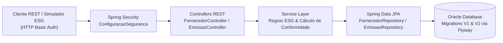

# API ESG — Transparência e Conformidade na Cadeia de Suprimentos


[](https://renan-xavier.vercel.app)

**Autor:** Renan Santa Rosa Xavier — RM566997 | 🌐 **Portfólio:** [renan-xavier.vercel.app](https://renan-xavier.vercel.app)

---

## Visão Geral do Projeto

API RESTful desenvolvida em **Java 21 com Spring Boot 3** para o controle de fornecedores, rastreamento de **emissões de carbono de Escopo 3** e diagnóstico automatizado de **conformidade ESG** na cadeia de suprimentos.


---

## Arquitetura da Solução



### Destaques Técnicos e Apresentação do Projeto
| Arquitetura e Contexto ESG | Containerização (Docker & Compose) | Testes Automatizados da API |
| :---: | :---: | :---: |
|  |  |  |

- **Java 21 & Spring Boot 3:** Arquitetura em camadas (`controller`, `service`, `repository`, `dto`, `model`, `excecao`, `seguranca`).
- **Migrações Versionadas com Flyway:** Criação automática das tabelas (`V1__criar_tabelas_esg.sql`) e carga inicial de fornecedores e emissões (`V2__inserir_dados_iniciais.sql`).
- **Validação e Tratamento Global de Erros:** Uso de Bean Validation (`@Valid`) e respostas padronizadas com `ProblemDetail` (`TratadorGlobalExcecoes`).
- **Segurança:** Autenticação HTTP Basic configurada via `Spring Security`.
- **Containerização Completa:** `Dockerfile` multi-stage e `docker-compose.yml` orquestrando a API e o banco de dados.

---

## Endpoints Principais

| Método | Rota | Descrição |
| :---: | :--- | :--- |
| `GET` | `/fornecedores` | Lista todos os fornecedores cadastrados na cadeia de suprimentos |
| `POST` | `/fornecedores` | Cadastra um novo fornecedor com meta anual de emissões (`tCO2e`) |
| `GET` | `/fornecedores/{id}/conformidade` | Calcula o diagnóstico de conformidade ESG comparando emissões auditadas com a meta |
| `POST` | `/emissoes` | Registra um novo relatório de emissão de carbono de Escopo 3 |
| `GET` | `/emissoes/{id}` | Consulta os detalhes de um relatório de emissão específico |
| `PUT` | `/emissoes/{id}` | Atualiza dados e aprova a auditoria (`PENDENTE` → `AUDITADO`) |
| `DELETE` | `/emissoes/{id}` | Invalida/remove um relatório de emissão |

---

## Como Executar

### 1. Subir via Docker Compose
```bash
docker compose up --build
```

### 2. Executar Testes de Integração via Maven
```bash
mvn clean test
```

### Credenciais de Acesso (HTTP Basic Auth)
- **Usuário:** `admin`
- **Senha:** `esg123`
