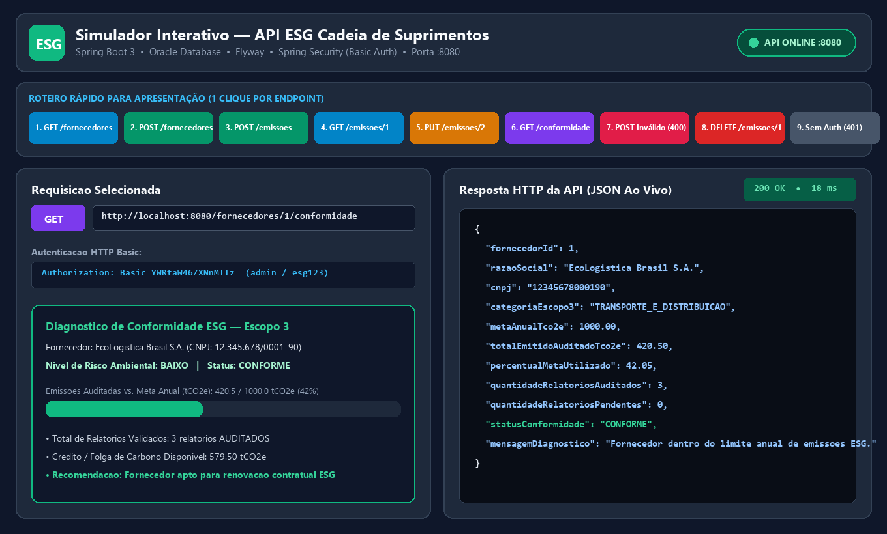
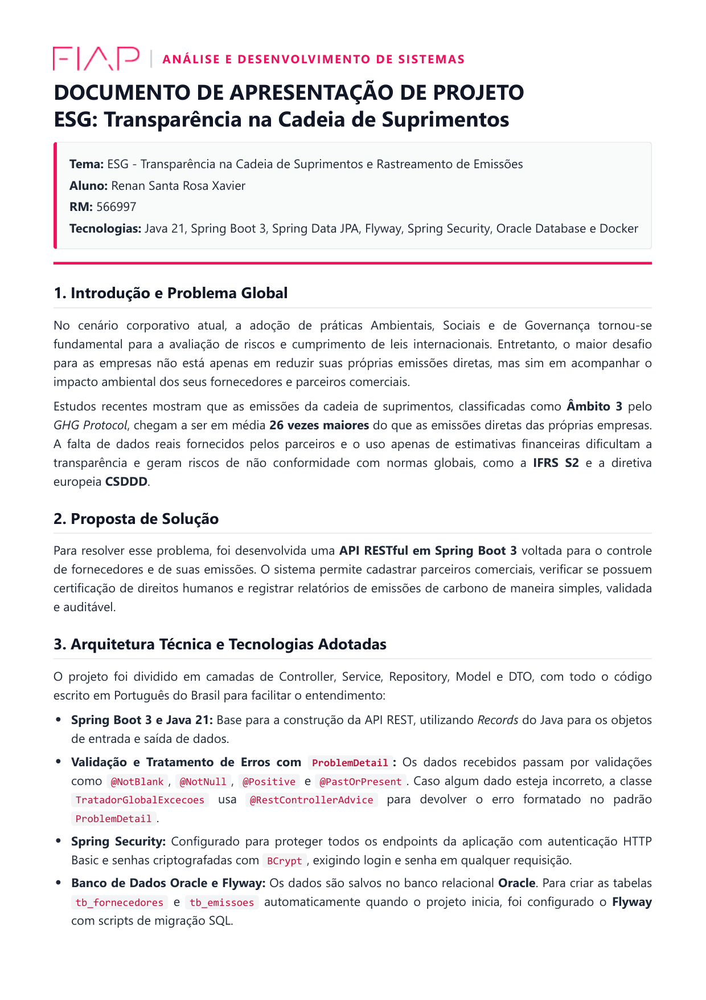
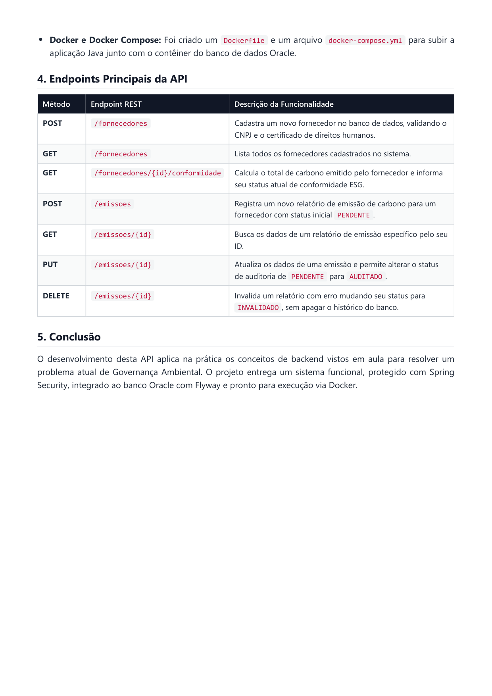
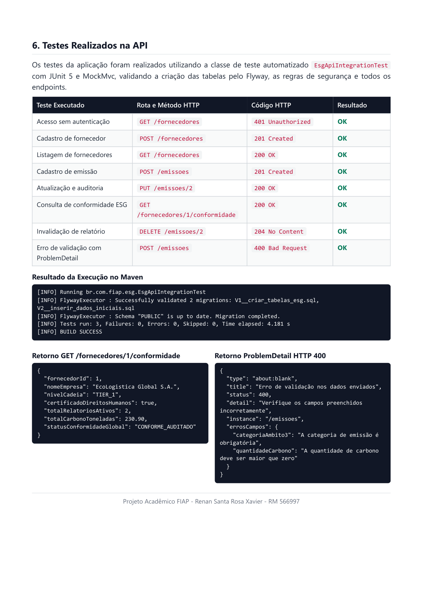
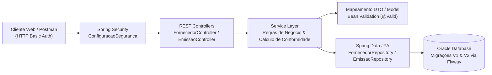

# ESG Spring API — Gestão de Carbono e Conformidade na Cadeia de Suprimentos


[](https://renan-xavier.vercel.app)

**Autor:** Renan Santa Rosa Xavier — RM566997 | 🌐 **Portfólio:** [renan-xavier.vercel.app](https://renan-xavier.vercel.app)

---

## 📌 Visão Geral

Esta API RESTful foi desenvolvida em **Java 21 com Spring Boot 3** para rastreamento de **emissões de carbono de Escopo 3** e auditoria automatizada de **conformidade ESG** em fornecedores corporativos.

O sistema recebe relatórios periódicos de emissões, compara os volumes auditados com as metas contratuais de cada fornecedor e calcula automaticamente o status de conformidade (`EM_CONFORMIDADE`, `ALERTA` ou `NAO_CONFORME`).

---

## 🎬 Demonstração do Sistema

A API conta com um simulador web interativo para testes visuais e validação dos fluxos de cadastro, envio de relatórios e auditoria em tempo real:



### Apresentação Executiva do Projeto
| Arquitetura & Regras ESG | Dockerfile & Orquestração | Validação dos Endpoints via Postman/Maven |
| :---: | :---: | :---: |
|  |  |  |

---

## 🏛️ Arquitetura da Solução

O projeto segue arquitetura em camadas desacopladas com isolamento de responsabilidades:



---

## 🛠️ Tecnologias Utilizadas

| Tecnologia | Finalidade no Projeto |
| :--- | :--- |
| **Java 21 (LTS)** | Linguagem base com recursos modernos (Records, Pattern Matching e novas APIs). |
| **Spring Boot 3.x** | Framework para estruturação da API REST, injeção de dependências e configuração. |
| **Spring Data JPA & Hibernate** | Abstração da camada de persistência e mapeamento objeto-relacional. |
| **Oracle Database** | SGBD relacional corporativo utilizado para armazenamento seguro das entidades. |
| **Flyway** | Versionamento e execução automática de scripts SQL (`V1__criar_tabelas` e `V2__dados_iniciais`). |
| **Spring Security** | Autenticação HTTP Basic protegendo endpoints sensíveis de escrita e auditoria. |
| **Bean Validation & ProblemDetail** | Validação de payloads e tratamento global de erros no padrão RFC 7807. |
| **Docker & Docker Compose** | Containerização da aplicação com build multi-stage e provisionamento do banco. |

---

## 🔌 Endpoints da API

| Método | Endpoint | Descrição |
| :---: | :--- | :--- |
| `GET` | `/fornecedores` | Lista fornecedores cadastrados na cadeia de suprimentos |
| `POST` | `/fornecedores` | Cadastra novo fornecedor com meta anual (`tCO2e`) |
| `GET` | `/fornecedores/{id}/conformidade` | Calcula conformidade comparando emissões auditadas com a meta |
| `POST` | `/emissoes` | Registra novo relatório de emissão de Escopo 3 |
| `GET` | `/emissoes/{id}` | Consulta detalhes de um relatório de emissão |
| `PUT` | `/emissoes/{id}` | Atualiza dados e avança auditoria (`PENDENTE` → `AUDITADO`) |
| `DELETE` | `/emissoes/{id}` | Invalida/remove um relatório de emissão |

---

## 🚀 Como Executar Localmente

### Pré-requisitos
* **Docker** e **Docker Compose** instalados (ou JDK 21 + Maven caso execute sem Docker).

### 1. Subir com Docker Compose
```bash
# Constrói a imagem da aplicação e sobe os containers da API e do banco
docker compose up --build
```

### 2. Executar Testes Automatizados via Maven
```bash
mvn clean test
```

### 🔑 Credenciais Padrão (HTTP Basic Auth)
* **Usuário:** `admin`
* **Senha:** `esg123`
